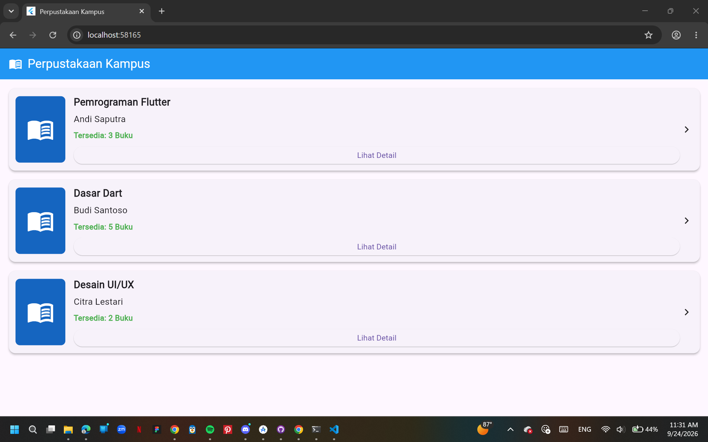
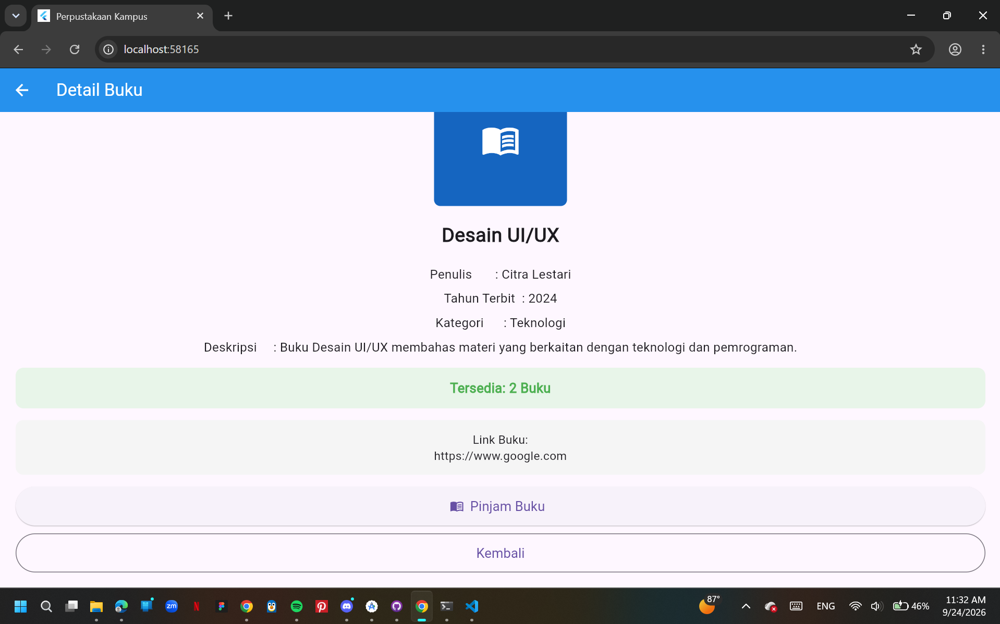
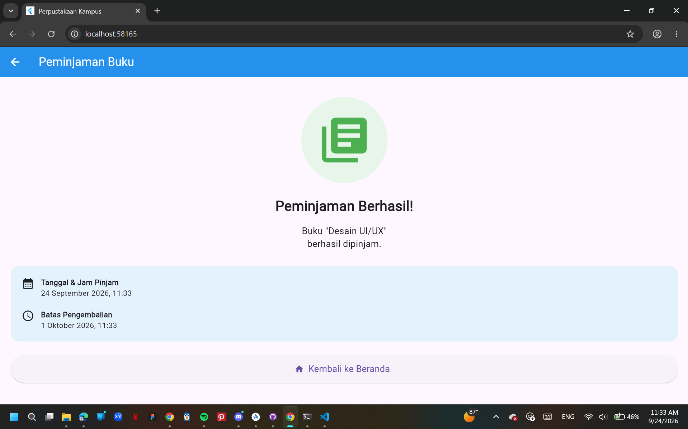

# Laporan Praktikum: Navigasi & Routing

- **Nama**: Safitri Yudiastuti
- **NIM**: 362558302077
- **Kelas / Prodi**: 2E / Sarjana Terapan TRPL
- **Mata Kuliah**: Pemrograman Perangkat Bergerak (Semester 3)

---

## 1. Ringkasan Implementasi
Praktikum ini mengimplementasikan sistem navigasi multi-halaman pada aplikasi **Perpustakaan Kampus** menggunakan desain antarmuka Material 3. Alur perpindahan halaman dirancang sebagai berikut:
- **`Navigator.push()`**: Digunakan pada `HomePage` saat tombol "Lihat Detail" ditekan untuk menumpuk halaman `DetailPage` di atas *stack* navigasi.
- **`Navigator.pushReplacement()`**: Digunakan pada `DetailPage` saat tombol "Pinjam Buku" ditekan, sehingga halaman detail dihapus dari *stack* dan digantikan langsung oleh `SuccessPage`.
- **`Navigator.pop()`**: Digunakan untuk aksi tombol "Kembali", membuang halaman aktif saat ini dan mengembalikan pengguna ke halaman sebelumnya (atau kembali ke beranda dari `SuccessPage`).

## 2. Bukti Tangkapan Layar (Running App)
| Halaman Beranda (HomePage) | Halaman Detail Buku (DetailPage) | Halaman Sukses (SuccessPage) |
|---|---|---|
|  |  |  |

## 3. Kendala Layout yang Dihadapi & Solusinya
- **Kendala**: Terjadi *error* `BOTTOM OVERFLOWED BY 8.0 PIXELS` (muncul pita kuning-hitam) di bagian bawah halaman `SuccessPage`. Hal ini terjadi karena ukuran tinggi layar perangkat tidak mencukupi untuk merender seluruh susunan *widget* di dalam `Column` utama, terutama posisi tombol "Kembali ke Beranda".
- **Solusi**: Membungkus *widget* `Column` beserta seluruh isinya ke dalam `SingleChildScrollView`, lalu meletakkannya di dalam *widget* `Center`. Penyesuaian ini membuat area konten menjadi *scrollable* (dapat digulir) jika ukuran layar terbatas, sehingga *overflow* teratasi dengan aman.

## 4. Jawaban Pertanyaan Refleksi
1. **Efisiensi Single-pass BoxConstraints**: Flutter melakukan proses *layouting* dalam satu kali lintasan (*single-pass*) yang sangat cepat. Pada halaman `HomePage`, *widget* `ListView` memberikan kebebasan batasan ruang vertikal (*unbounded constraint*) kepada setiap item daftar. Dengan mekanisme ini, kartu buku dapat menghitung dan merender ukuran tingginya secara dinamis berdasarkan konten teks di dalamnya (seperti judul yang panjang) tanpa membebani performa aplikasi.
2. **Kriteria Modularisasi Widget**: Modularisasi (*refactoring*) ke dalam fungsi terpisah dilakukan untuk mencegah duplikasi kode pada *widget* yang digunakan berulang kali. Pada praktikum ini, pembuatan tata letak kartu pada `HomePage` dipisah ke fungsi `_buildBookCard()`, dan baris informasi pada halaman detail dipisah ke `_buildDetailRow()`. Kriterianya adalah ketika sebuah komponen visual dipanggil lebih dari satu kali dan hanya memiliki perbedaan pada data yang ditampilkan (seperti teks atau ikon).
3. **Manfaat M3 ThemeData Terpusat**: Dengan menetapkan `ThemeData(useMaterial3: true)` dan menentukan `ColorScheme.fromSeed()` di file `main.dart`, seluruh desain visual menjadi konsisten secara otomatis. Komponen seperti `AppBar`, efek *ripple* pada tombol `ElevatedButton`, dan *styling* warna dasar (seperti teks dan latar) akan mengikuti tema utama Material 3. Hal ini menghilangkan keharusan untuk melakukan modifikasi warna dan desain pada setiap *widget* secara manual.

link github : https://github.com/safitriyudiastuti-commits/project-M03-362558302077-SafitriYudiastuti.git